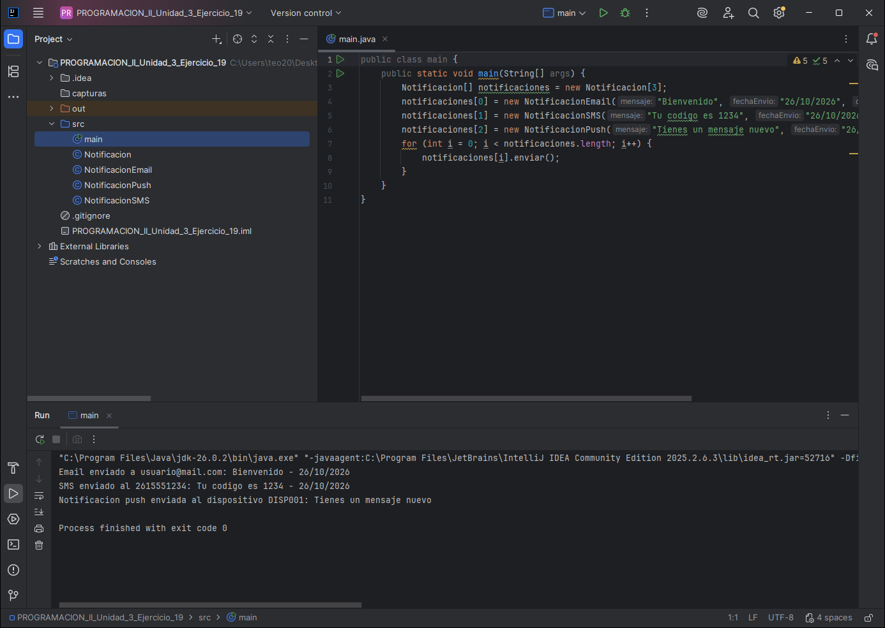

# PROGRAMACIÓN II — Unidad 3, Ejercicio 19: La Agenda de Contactos y Validación de Teléfonos

Trabajo práctico de Programación II. Este repositorio contiene la resolución en Java del ejercicio 19 de la Unidad 3.

## Consigna

#### Contexto

Una aplicación de agenda telefónica protege los datos de los contactos almacenados para asegurar que los números ingresados cumplan con las longitudes y caracteres mínimos requeridos por el sistema de llamadas.

#### Consigna

Construir un modelo orientado a objetos en Java que administre un contacto telefónico aplicando encapsulamiento sobre su número y correo electrónico.

#### Desarrollo requerido

- Definir la clase Contacto con atributos privados para el nombre, el número de teléfono y el correo electrónico.
- Proveer métodos modificadores (setters) que validen que el correo contenga el carácter '@' y que el teléfono no contenga letras antes de actualizar los campos privados.
- Exponer métodos de consulta seguros que devuelvan una representación formateada de los datos del contacto.
- En el método main, crear una instancia de contacto, intentar asignar valores correctos e incorrectos, y verificar los cambios por consola.

## Estructura del repositorio

```
PROGRAMACION_II_Unidad_3_Ejercicio_19/
├── README.md
├── capturas/
│   └── consola.png
└── src/
    ├── main.java   # clase con el método main
    ├── Notificacion.java
    ├── NotificacionEmail.java
    ├── NotificacionPush.java
    └── NotificacionSMS.java
```

## Funcionamiento y lógica

El ejercicio aplica **herencia y polimorfismo** para enviar notificaciones por distintos canales.

### `Notificacion` (clase base)

Tiene los atributos `protected` `mensaje` y `fechaEnvio`, y un método `enviar()` general.

### Subclases

Cada una hereda de `Notificacion`, agrega el dato que necesita su canal y sobrescribe `enviar()`:

- **`NotificacionEmail`:** guarda la dirección de correo y muestra el email enviado con el mensaje y la fecha.
- **`NotificacionSMS`:** guarda el número de teléfono y muestra el SMS enviado.
- **`NotificacionPush`:** guarda el identificador del dispositivo y muestra la notificación push enviada.

### `main`

Crea un **arreglo** de tipo `Notificacion` con un email de bienvenida, un SMS con un código y una notificación push. Lo recorre con un `for` llamando a `enviar()` en cada posición, y cada objeto se envía por su propio canal.

## Ejecución

Captura de la consola de IntelliJ IDEA ejecutando el programa:



Salida obtenida:

```
Email enviado a usuario@mail.com: Bienvenido - 26/10/2026
SMS enviado al 2615551234: Tu codigo es 1234 - 26/10/2026
Notificacion push enviada al dispositivo DISP001: Tienes un mensaje nuevo
```
